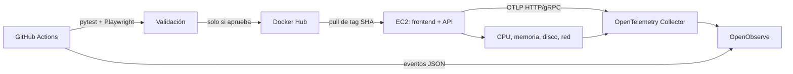

# Entrega continua y observabilidad en AWS EC2

Aplicación de demostración para el Proyecto Parcial 2. Incluye frontend, API FastAPI, pruebas pytest y Playwright, publicación condicional de imágenes Docker, despliegue remoto por SSH y telemetría OpenTelemetry hacia OpenObserve.

## Arquitectura



## Ejecutar en local

Requiere Python 3.12 o superior.

```powershell
python -m venv .venv
.\.venv\Scripts\Activate.ps1
pip install -r requirements-dev.txt
playwright install chromium
uvicorn backend.app:app --reload
```

En otra terminal: `pytest -q`. La API sirve la UI y endpoints bajo el mismo host. Para ejecutar la pila Docker, copia `.env.example` a `.env`, cambia la contraseña y el usuario de Docker Hub, después ejecuta `docker compose up -d`. En producción, primero publica imágenes; el pipeline lo hace al superar pytest y Playwright.

## GitHub Actions y secretos

Configura estos secrets en **Settings → Secrets and variables → Actions**:

| Secret | Valor |
| --- | --- |
| `DOCKERHUB_USERNAME` | Usuario de Docker Hub |
| `DOCKERHUB_TOKEN` | Token de acceso Docker Hub con permiso de escritura |
| `EC2_HOST` | IP pública o DNS de la EC2 |
| `EC2_USER` | Usuario SSH, por ejemplo `ubuntu` |
| `EC2_SSH_KEY` | Clave privada SSH completa de despliegue |
| `OO_URL` | URL base de OpenObserve, por ejemplo `http://<host>:5080` |
| `OO_USER` | Usuario OpenObserve |
| `OO_PASSWORD` | Contraseña OpenObserve |

Los eventos de prueba y despliegue se transmiten incluso si falla el job correspondiente. El job de despliegue depende de `tests` y se ejecuta sólo en `main`; pull requests nunca despliegan. Los eventos quedan en el stream `ci_pipeline`.

## Preparar EC2

Usa Ubuntu 24.04 LTS x86_64, al menos 2 vCPU y 4 GB RAM para la demostración con OpenObserve. Autoriza TCP/22 sólo desde tu IP y TCP/80 para la aplicación; no publiques 5080 ni 4317/4318. Instala Docker Engine y Compose plugin, clona el repositorio en `~/parcial2`, crea `~/parcial2/.env` con las variables del ejemplo y credenciales únicas, luego configura los secrets de GitHub. Conserva la clave SSH y contraseñas fuera del repositorio.

La consola de OpenObserve queda ligada a `127.0.0.1:5080`; accede con un túnel SSH (`ssh -L 5080:127.0.0.1:5080 ubuntu@<EC2_HOST>`) y abre `http://localhost:5080`. Crea paneles de logs (`ci_pipeline` y logs de aplicación), trazas, métricas `http.server.request.count` y `http.server.request.duration`, y métricas de host `system.cpu`, `system.memory`, `system.network`, `system.filesystem`. Las alarmas se configuran desde OpenObserve sobre esos streams.

## Alcance medible

El collector reporta CPU, memoria, almacenamiento, paginación y red de Linux. EC2 no expone de forma estándar temperatura física del host en una VM; por eso no se puede afirmar una gráfica de temperatura fiable sin sensor o métrica del proveedor. La aplicación genera trazas automáticas de FastAPI, logs estructurados y métricas OTLP de conteo y latencia por método, ruta y código HTTP.

## URLs

- Repositorio: completar después de crear el repo remoto.
- Aplicación EC2: completar después del despliegue.
- OpenObserve: acceso privado por túnel SSH, no publicar credenciales.
