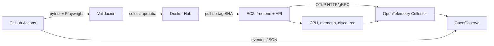

# Entrega continua y observabilidad en AWS EC2

Aplicación de demostración para el Proyecto Parcial 2. Incluye frontend, API FastAPI, pruebas pytest y Playwright, publicación condicional de imágenes Docker, despliegue remoto por SSH y telemetría OpenTelemetry hacia OpenObserve.

## Arquitectura



## Ejecutar en local

Requiere Python 3.12 o superior.

```powershell
python -m venv .venv
.\.venv\Scripts\Activate.ps1
pip install -r requirements-dev.txt
playwright install chromium
uvicorn backend.app:app --reload
```

En otra terminal: `pytest -q`. La API sirve la UI y endpoints bajo el mismo host. Para ejecutar la pila Docker, copia `.env.example` a `.env`, cambia la contraseña y el usuario de Docker Hub, después ejecuta `docker compose up -d`. En producción, primero publica imágenes; el pipeline lo hace al superar pytest y Playwright.

## GitHub Actions y secretos

Configura estos secrets en **Settings → Secrets and variables → Actions**:

| Secret | Valor |
| --- | --- |
| `DOCKERHUB_USERNAME` | Usuario de Docker Hub |
| `DOCKERHUB_TOKEN` | Token de acceso Docker Hub con permiso de escritura |
| `EC2_HOST` | IP pública o DNS de la EC2 |
| `EC2_USER` | Usuario SSH, por ejemplo `ubuntu` |
| `EC2_SSH_KEY` | Clave privada SSH completa de despliegue |
| `OO_URL` | URL base de OpenObserve, por ejemplo `http://<host>:5080` |
| `OO_USER` | Usuario OpenObserve |
| `OO_PASSWORD` | Contraseña OpenObserve |

Los eventos de fallas de prueba y de despliegue se transmiten incluso si falla el job correspondiente. Las corridas válidas registran el resultado de pruebas después de que OpenObserve está disponible. El job de despliegue depende de `tests` y se ejecuta sólo en `main`; pull requests nunca despliegan. Los eventos quedan en el stream `ci_pipeline`.

## Preparar EC2

La instancia de demostración activa es Ubuntu x86_64 `t3.small` en `us-east-2`, con 2 GiB de RAM y 2 GiB de swap. OpenObserve puede funcionar con este tamaño, pero 4 GiB o más dan margen para cargas mayores. El grupo de seguridad permite TCP/80 y TCP/22; SSH usa una llave Ed25519 y debe restringirse a rangos de confianza cuando sea posible. No publiques 5080 ni 4317/4318. El workflow instala Docker Engine y Compose plugin, configura `~/parcial2/.env` con permisos privados y actualiza los servicios después de las pruebas. Conserva las credenciales y claves fuera del repositorio.

La consola de OpenObserve queda ligada a `127.0.0.1:5080`; no tiene exposición pública. En PowerShell, abre el túnel y deja esa terminal activa:

```powershell
ssh -i "$env:USERPROFILE\.ssh\parcial2-cicd-ec2" -o StrictHostKeyChecking=yes -o UserKnownHostsFile="$env:USERPROFILE\.ssh\parcial2-ec2-known-hosts-correct" -N -L 5080:127.0.0.1:5080 ubuntu@18.116.201.62
```

Después abre `http://localhost:5080`. El tablero **Parcial 2 CI CD y Observabilidad** tiene siete paneles: eventos `test`/`deploy`, solicitudes y latencia HTTP, CPU, memoria, tráfico de red y trazas de la API. El flujo validado registra eventos en `ci_pipeline`. El JSON exportado del tablero está en [`observability/dashboard.json`](observability/dashboard.json). Las reglas de alerta y su destino de notificación aún deben configurarse desde OpenObserve.

## Alcance medible

El collector reporta CPU, memoria, almacenamiento, paginación y red de Linux. EC2 no expone de forma estándar temperatura física del host en una VM; por eso no se puede afirmar una gráfica de temperatura fiable sin sensor o métrica del proveedor. La aplicación emite logs estructurados, métricas OTLP de conteo/latencia por método, ruta y código HTTP, y spans HTTP explícitos. Se verificó la recepción HTTP 200 de logs, métricas y trazas en OpenObserve.

## URLs

- Repositorio: https://github.com/axelisaak10/parcial2-cicd-observabilidad
- Imagen API (Docker Hub): https://hub.docker.com/r/34axel/parcial2-api
- Imagen frontend (Docker Hub): https://hub.docker.com/r/34axel/parcial2-frontend
- Aplicación EC2: http://18.116.201.62/ (salud: http://18.116.201.62/health)
- OpenObserve: http://localhost:5080 tras iniciar el túnel SSH; credenciales fuera del repositorio.
